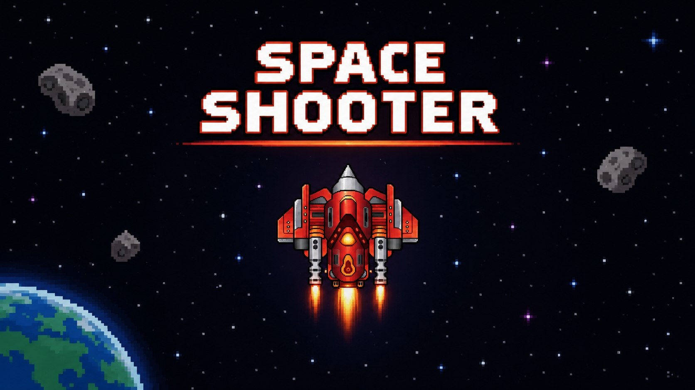
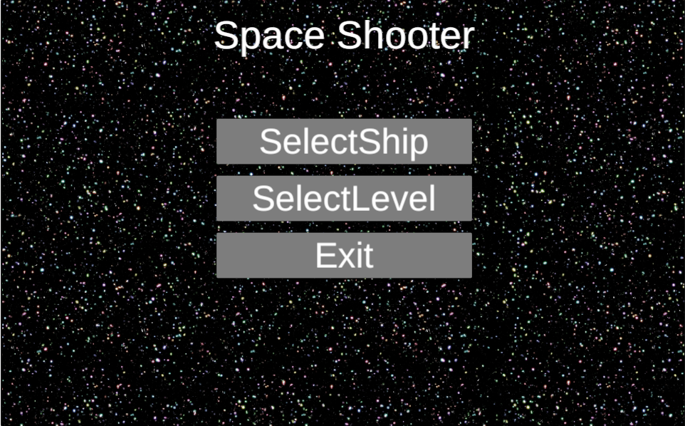
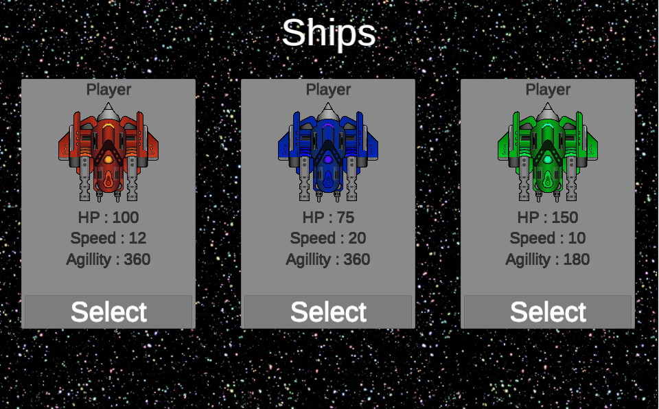
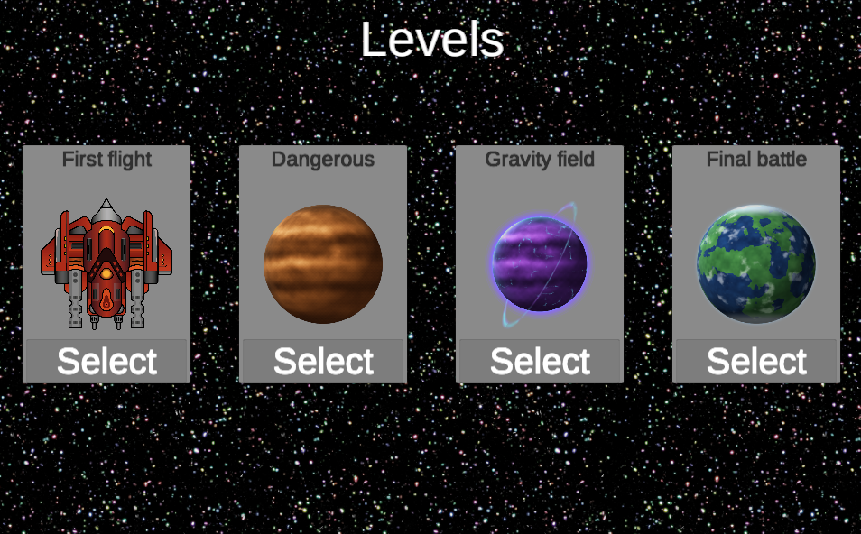
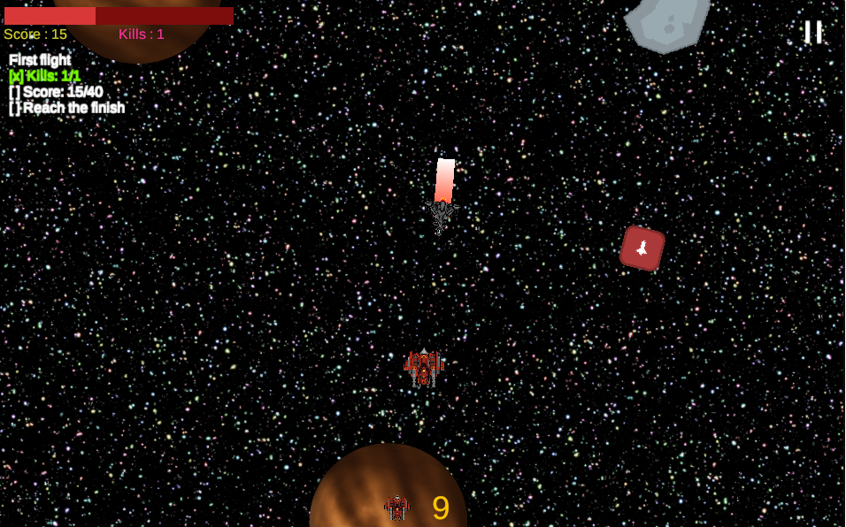
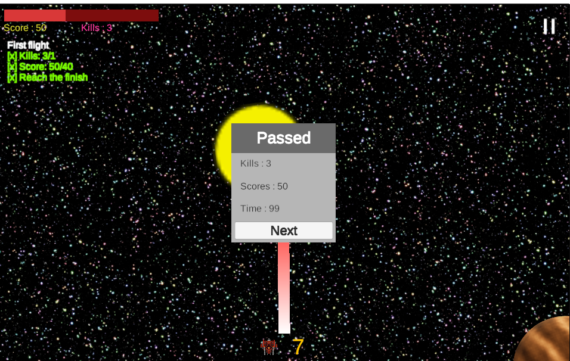
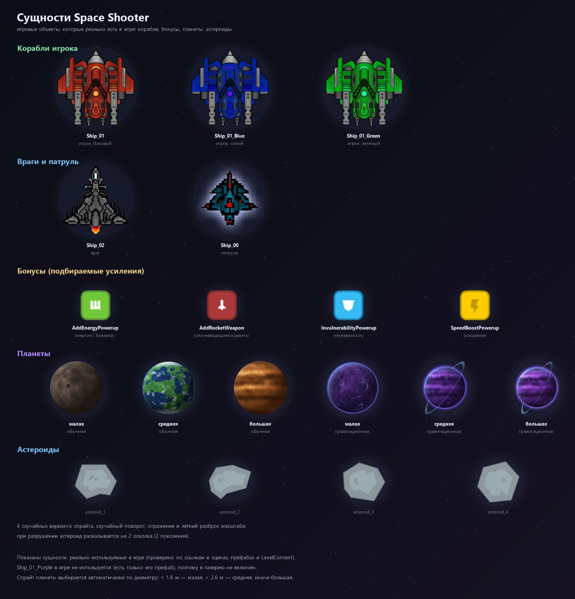

# Space Shooter



A 2D top-down arcade space shooter built with **Unity**. Pilot a ship through
procedurally populated arenas, destroy enemy ships and asteroids, collect
power-ups and complete each level's objectives.

---

## About the Game

Space Shooter is a single-player 2D top-down space shooter. The player controls a
spacecraft with thrust-and-rotation movement inside a circular arena. Every level
has its own objectives — destroy a required number of enemies, earn a required
score and reach the finish point — and levels are played in a fixed sequence.

The game contains:

- **4 levels**, each with its own content and difficulty:
  1. *First flight*
  2. *Dangerous bombs*
  3. *Gravity field*
  4. *Final battle*
- **3 selectable player ships**, which differ in hit points, top speed and agility
  (hit points 100 / 75 / 150, top speed 12 / 20 / 10, agility 360 / 360 / 180).
- Enemy ships, asteroids, gravity wells, hazard walls and power-ups.

When a level is loaded, the arena is populated procedurally, so the placement of
decorative planets, gravity wells, hazard walls, patrol ships and power-ups is
different on every run.

---

## Features

- **Thrust-and-rotation movement** — the ship is driven by 2D physics
  (`Rigidbody2D`) with configurable thrust, torque, top speed and agility.
- **3 player ships** with different stats, selected from the main menu before a
  level starts.
- **Two kinds of enemy ships:**
  - **Attacking enemy ship** — heads straight for the player and attacks.
  - **Patrol enemy ship** — patrols an assigned area and attacks the player as
    soon as the player enters its aggro radius.
- **Turrets are weapon modules mounted directly on ships** — they are fitted both
  to the player ship and to enemy ships. There are **no separate stationary
  turrets on the level**. Each ship carries two weapon types:
  - **Primary weapon** — energy shots; its energy regenerates over time.
  - **Secondary weapon** — a homing-rocket launcher; it consumes ammo.
- **Power-ups:**
  - energy / ammo refill,
  - homing rocket weapon,
  - temporary invulnerability,
  - temporary speed boost.
- **Destructible asteroids** that split into smaller fragments when destroyed
  (up to two generations).
- **Gravity wells** (gravity planets) that pull ships within their radius; on
  higher difficulties they periodically reverse the pull direction.
- **Hazard walls** that destroy a ship on collision.
- **Procedural level population** — planets, gravity wells, walls, patrol ships
  and power-ups are placed randomly every time a level is loaded.
- **Score and kills** are awarded when a target is destroyed (not per hit).
- **Lives and respawn** — the player has a number of lives; losing a ship
  respawns it while lives remain.
- **HUD** — hit-point bar, kills counter, score counter, lives indicator and a
  live level-objective hint that marks completed objectives.
- **Menus and panels** — main menu with ship and level selection, an in-game pause
  panel and a results panel (kills, score, time) with next / restart / main-menu
  actions.
- **Keyboard and touch controls** — the control scheme is detected automatically
  and can be switched on the fly.

---

## Controls

### Keyboard (PC)

| Action | Keys |
| --- | --- |
| Thrust forward | `W` or `Up Arrow` |
| Thrust backward | `S` or `Down Arrow` |
| Rotate left | `A` or `Left Arrow` |
| Rotate right | `D` or `Right Arrow` |
| Fire primary weapon | `Space` |
| Fire secondary weapon | `X` |
| Return to the main panel | `Esc` (in menus) |

### Touch (mobile)

- **Virtual joystick** — thrust and rotation.
- **Fire buttons** — one for the primary weapon and one for the secondary weapon.

The game detects whether the primary input device is a touch screen and shows the
on-screen gamepad automatically; touching the screen switches to touch controls,
and pressing a gameplay key switches back to the keyboard.

---

## Technologies

- **Unity 2022.3.62f3**
- **C#**
- **Unity 2D physics** (`Rigidbody2D`, `Collider2D`, `Physics2D`)
- **Unity UI (uGUI)** for menus, HUD and the on-screen gamepad
- **ScriptableObjects** for level data (`LevelProperties`, `LevelSequences`) and
  for weapon data (`TurretProperties`)
- **WebGL build target** with a small JavaScript plugin used to detect
  touch-primary devices
- **Packages** (see `Packages/manifest.json`): 2D feature set, TextMesh Pro,
  uGUI, Timeline, Visual Scripting, and the standard Unity modules

---

## How to Run the Project

### Requirements

- Unity **2022.3.62f3** (or a compatible 2022.3 LTS version).
- All required game assets are included in the repository.

### Steps

1. Clone the repository.
2. In Unity Hub, choose **Add** and select the project folder.
3. Open the scene `Assets/Scenes/main_menu.unity`.
4. Press **Play**.

### Building for the web (optional)

1. Open **File → Build Settings**.
2. Select **WebGL** and switch the platform.
3. Add the scenes from `Assets/Scenes` to the build.
4. Press **Build**.

---

## Project Structure

```
Space Shooter/
├─ Assets/
│  ├─ Audio/                 Sound effects and music
│  ├─ CodeBase/              All game C# scripts
│  │  ├─ Common/             Game-agnostic base classes (Entity, DestructibleBase,
│  │  │                      ProjectileBase, TurretBase, input, helpers)
│  │  ├─ Gameplay/           Game-specific systems
│  │  │  ├─ AI/              Enemy AI (AIController, AIPointPatrol)
│  │  │  ├─ Camera/          Follow camera
│  │  │  ├─ Combat/          Destructible objects and collision damage
│  │  │  ├─ Environment/     Asteroids, gravity wells, hazard walls, planets
│  │  │  ├─ LevelLogic/      Level controller, boundary, procedural randomizer,
│  │  │  │                   completion conditions
│  │  │  ├─ Player/          Player and ship input
│  │  │  ├─ Powerups/        Power-up types
│  │  │  ├─ Projectiles/     Projectiles and homing rockets
│  │  │  ├─ Services/        Player spawner, level builder, project services
│  │  │  ├─ Ships/           SpaceShip
│  │  │  ├─ Spawners/        Entity spawners
│  │  │  ├─ Turrets/         Turret and turret properties
│  │  │  └─ UI/              Menus, panels, HUD indicators, virtual gamepad
│  │  └─ Infrastructure/     Singleton base
│  ├─ Materials/             Materials
│  ├─ Plugins/WebGL/         WebGL JavaScript plugin (touch detection)
│  ├─ Prefabs/               Ships, projectiles, power-ups, planets, asteroids, UI
│  ├─ Resources/             Level content and level sequences assets
│  ├─ Scenes/                main_menu + Level_01 … Level_04
│  ├─ ScriptableObjects/     Level and turret data assets
│  ├─ TextMesh Pro/          TextMesh Pro resources
│  └─ Textures/              Sprites (ships, planets, asteroids, power-ups,
│                            backgrounds)
├─ Packages/                 Package manifest
└─ ProjectSettings/          Unity project settings
```

---

## Screenshots

### Main Menu



### Ship Selection



### Level Selection



### Gameplay



### Level Completed



### Game Assets



This image shows the game entities used in the project.

---

## Play the Game

[Play on itch.io](https://pelmefkka.itch.io/spaceshooter)
